# Commande vectorielle d’un moteur asynchrone à cage

**Étude d’un entraînement de 5 kW avec les blocs fondamentaux de Simulink, Simscape Electrical et Python**

## 1. Pourquoi utiliser la commande vectorielle ?

Dans un moteur asynchrone, le couple résulte de l’interaction du courant statorique et du flux rotorique. Les courants de phase sont alternatifs et le flux tourne à une vitesse différente de celle du rotor. Dans les grandeurs triphasées, il est difficile de distinguer la part du courant qui aimante la machine de celle qui produit le couple.

La commande vectorielle, ou FOC, exprime le courant statorique dans un repère qui suit le flux rotorique. La composante $i_d$, dans la direction du flux, règle l’aimantation. La composante perpendiculaire $i_q$ règle le couple à flux donné. La boucle de vitesse demande alors le couple nécessaire pour accélérer la machine ou compenser une variation de charge.

## 2. Architecture de commande

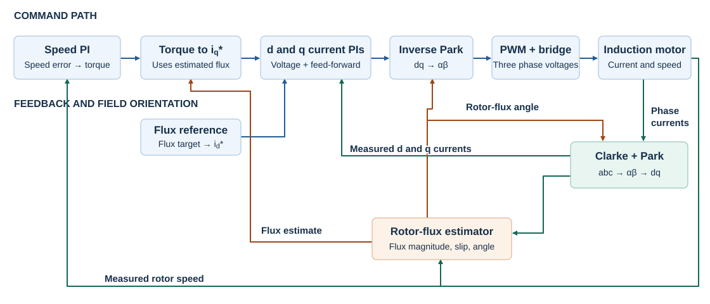

Le PI de vitesse transforme l’écart entre vitesse de consigne et vitesse du modèle moteur en une demande de couple $T_e^*$. Le flux estimé sert à calculer le courant nécessaire à ce couple. La consigne de flux fixe le courant d’aimantation.

$$
i_q^*=\frac{T_e^*}{K_T\hat{\psi}_r},\qquad
K_T=\frac32p\frac{L_m}{L_r},\qquad
i_d^*=\frac{\psi_r^*}{L_m}.
$$

Avec $\psi_r^*=0{,}8$ Wb, on obtient $i_d^*=11{,}59$ A. Le couple demandé est limité à $\pm35$ N m et le courant en quadrature vérifie $|i_q^*|\leq\sqrt{I_{\max}^2-i_d^{*2}}$, avec $I_{\max}=25$ A. Un seuil minimal de flux protège le calcul au démarrage.

Les deux PI de courant calculent les tensions $v_d^*$ et $v_q^*$ à partir des erreurs de courant. Des termes d’anticipation compensent le couplage électrique. La transformation de Park inverse fournit les tensions dans le repère fixe. Le modulateur et l’onduleur appliquent ensuite la tension au moteur.

## 3. Transformations et orientation du flux rotorique

### 3.1 Clarke représente les trois phases dans un repère fixe

Les directions A, B et C sont à $0^\circ$, $120^\circ$ et $240^\circ$. On projette chaque grandeur sur les axes fixes $\alpha$ et $\beta$, puis on additionne les projections. Pour un système triphasé équilibré, cette somme donne $3/2$ de l’amplitude de phase. Le facteur $2/3$ rétablit l’amplitude d’origine.

$$
\begin{bmatrix}x_\alpha\\x_\beta\end{bmatrix}
=\frac23
\begin{bmatrix}1&-1/2&-1/2\\0&\sqrt3/2&-\sqrt3/2\end{bmatrix}
\begin{bmatrix}x_a\\x_b\\x_c\end{bmatrix}.
$$

Par exemple, $(10,-5,-5)$ A donne $(10,0)$ A. Les projections verticales des phases B et C s’annulent. Pour un réseau triphasé sans neutre, les deux coordonnées suffisent à décrire les courants dont la somme est nulle. La même transformation élimine un décalage de tension commun aux trois bornes de l’onduleur.

### 3.2 Park fait tourner les axes avec le flux

La transformation de Park exprime le vecteur dans un repère qui tourne à l’angle électrique $\theta_e$ du flux rotorique. L’axe d suit le flux et l’axe q le précède de $90^\circ$.

$$
\begin{bmatrix}x_d\\x_q\end{bmatrix}
=\begin{bmatrix}\cos\theta_e&\sin\theta_e\\-\sin\theta_e&\cos\theta_e\end{bmatrix}
\begin{bmatrix}x_\alpha\\x_\beta\end{bmatrix},\qquad
\begin{bmatrix}x_\alpha\\x_\beta\end{bmatrix}
=\begin{bmatrix}\cos\theta_e&-\sin\theta_e\\\sin\theta_e&\cos\theta_e\end{bmatrix}
\begin{bmatrix}x_d\\x_q\end{bmatrix}.
$$

Quand le repère est bien orienté, $(\psi_{rd},\psi_{rq})=(\psi_r,0)$. Le courant statorique peut garder ses deux composantes.

$$
\tau_r\frac{d\psi_r}{dt}+\psi_r=L_m i_d,\qquad
T_e=\frac32p\frac{L_m}{L_r}\psi_r i_q,\qquad
J\frac{d\omega_m}{dt}=T_e-T_L-B\omega_m.
$$

Le flux suit $i_d$ avec la constante de temps rotorique. À flux constant, le couple est proportionnel à $i_q$. La vitesse évolue selon l’écart entre le couple produit, la charge et les frottements. Si le flux augmente pour un même couple demandé, la conversion couple-courant demande moins de $i_q$.

### 3.3 Estimer le flux, le glissement et l’angle

1. **Module du flux.** Le modèle en courant filtre $i_d$ avec $\hat{\psi}_r(s)=L_m i_d(s)/(1+\tau_r s)$. La résistance rotorique $R_r$ intervient dans $\tau_r=L_r/R_r=87{,}0$ ms.
2. **Glissement électrique.** On calcule $\omega_{\rm sl}=L_m i_q/(\tau_r\max(\hat{\psi}_r,\psi_{\min}))$. À flux donné, le glissement augmente avec $i_q$.
3. **Angle du repère.** On ajoute le glissement à la vitesse électrique du rotor $p\omega_m$, puis on intègre. L’angle $\theta_e=\int(p\omega_m+\omega_{\rm sl})\,dt$ est celui du flux utilisé par Park et Park inverse.

### 3.4 Découplage des boucles de courant

L’orientation du repère fait apparaître les rôles de $i_d$ et $i_q$. Les équations de tension contiennent encore des termes croisés qui dépendent de la vitesse électrique. La commande ajoute les tensions d’anticipation suivantes.

$$
v_{d,\rm ff}=-\omega_e\sigma L_s i_q,\qquad
v_{q,\rm ff}=\omega_e\left(\sigma L_s i_d+\frac{L_m}{L_r}\hat{\psi}_r\right).
$$

Par exemple, une demande de couple plus élevée fait monter $i_q^*$. Le PI q augmente sa commande de tension et l’anticipation sur d aide le PI d à maintenir l’aimantation. L’estimation du flux sert à orienter les axes et à convertir le couple en courant. Les PI et les tensions d’anticipation agissent sur la dynamique de chaque courant.

| Boucle | Bande passante | Gain proportionnel | Gain intégral |
|---|---:|---:|---:|
| Courants d et q | 400 Hz | 9,91 V/A | 3030 V/(A s) |
| Vitesse | 30 Hz | 1,056 N m s/rad | 39,79 N m/rad |

Pour le courant, le modèle équivalent après compensation est $1/(\sigma L_s s+R_\sigma)$. Les gains sont $K_p=\sigma L_s\omega_{ci}$ et $K_i=R_\sigma\omega_{ci}$. Pour la vitesse, $K_p=J\omega_{cs}$ et $K_i=K_p\omega_{cs}/5$. La boucle de courant est plus rapide que celle de vitesse. Les versions à blocs fondamentaux et Python utilisent un anti-emballement par rétrocalcul. La version Simscape utilise le blocage conditionnel de l’intégration.

## 4. Modulation de l’onduleur triphasé

Un état à trois bits commande les bras A, B et C. Le bit `1` correspond à l’interrupteur haut, et le bit `0` à l’interrupteur bas. L’onduleur est alimenté par un bus de 540 V. Les deux modulations utilisent une fréquence de 10 kHz, soit une période de 100 µs.

### 4.1 MLI sinusoïdale (SPWM)

La transformation de Clarke inverse donne les consignes triphasées. Chaque consigne est divisée par $V_{dc}/2$, maintenue pendant une période et comparée à une porteuse triangulaire comprise entre $-1$ et $+1$. Lorsque la consigne dépasse la porteuse, la grille haute est activée. Une consigne plus élevée donne une impulsion plus large et donc une tension moyenne plus élevée. La limite linéaire en tension simple crête est $V_{dc}/2=270$ V. [Documentation MathWorks](https://www.mathworks.com/help/simscape-electrical/ref/pwmgeneratorthreephasetwolevel.html)

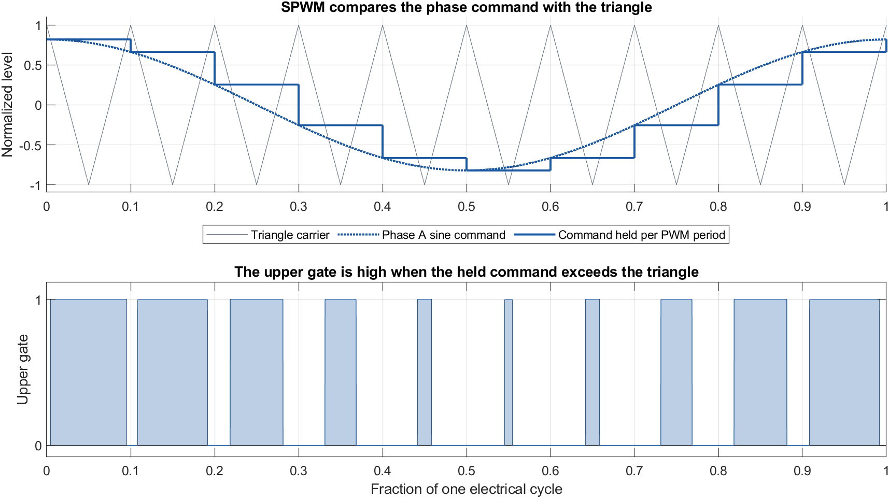

*La figure présente dix périodes de porteuse par période électrique pour rendre la comparaison visible. La simulation utilise une fréquence de 10 kHz.*

### 4.2 MLI vectorielle (SVPWM) et vecteurs de 360 V

Prenons le rail négatif comme référence à 0 V. L’état `100` donne $(540,0,0)$ V aux bornes A, B et C. La transformation de Clarke donne

$$
V_\alpha=\frac{V_{AB}+V_{AC}}{3}=\frac{540+540}{3}=360\ \mathrm V,\qquad
V_\beta=\frac{V_{BC}}{\sqrt3}=0.
$$

L’état `110` donne $(540,540,0)$ V, soit $(180,311{,}8)$ V dans le repère $\alpha\beta$. Il s’agit du même module de 360 V à $60^\circ$. Les six vecteurs actifs forment les sommets d’un hexagone. Les états `000` et `111` donnent une tension entre phases nulle, car toutes les bornes sont au même potentiel.

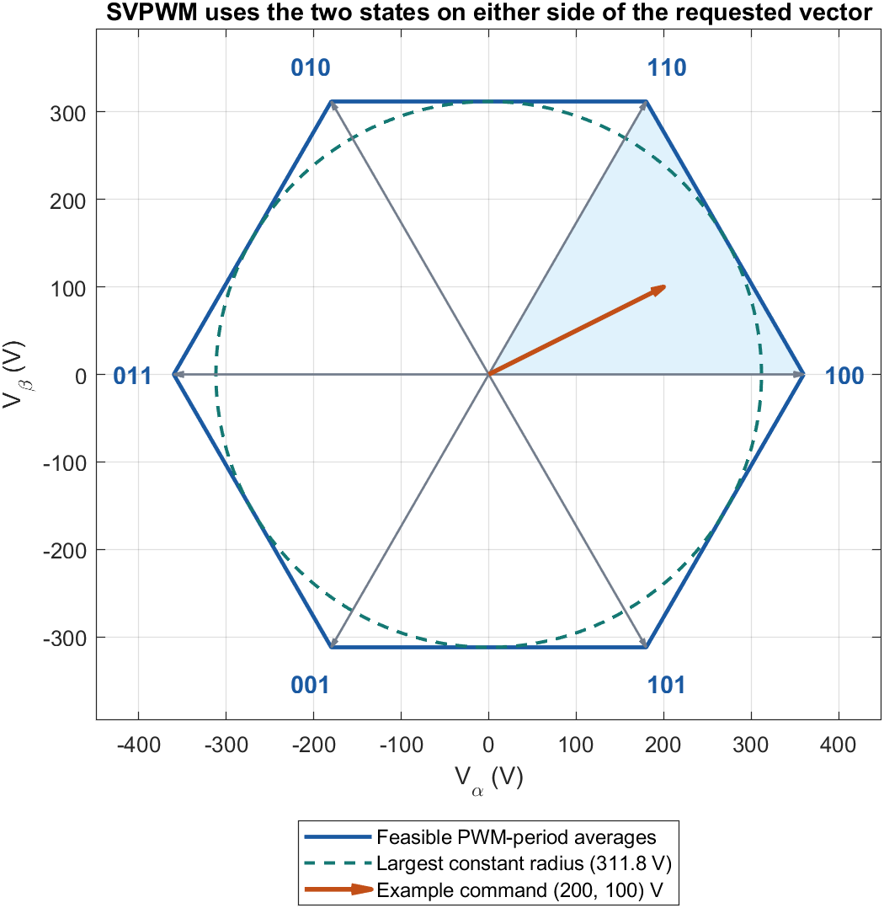

La valeur de 360 V correspond au sommet `100` sur l’axe $\alpha$. À $30^\circ$, la limite est sur le milieu du côté de l’hexagone, à $360\cos30^\circ=311{,}8$ V. Un vecteur tournant de module constant doit rester réalisable à tous les angles. La limite linéaire est donc $V_{dc}/\sqrt3=311{,}8$ V, soit environ 15,5 % de plus qu’en SPWM. [Hexagone et vecteurs actifs](https://imperix.com/doc/implementation/space-vector-modulation)

### 4.3 Séquence à sept segments

1. **Repérer le secteur.** La consigne $(V_\alpha^*,V_\beta^*)=(200,100)$ V est à $26{,}6^\circ$, entre `100` et `110`.
2. **Calculer les durées.** Pour obtenir 100 V en $\beta$, on utilise `110` pendant $100/311{,}8$ de la période, soit 32,08 µs. Il apporte aussi 57,7 V en $\alpha$. Il manque 142,3 V, fournis par `100` pendant 39,52 µs. Il reste 28,41 µs pour les états nuls.
3. **Disposer les états.** On part de `000`, on visite l’état à un bit haut, puis l’état à deux bits hauts, avant `111`. On revient dans l’ordre inverse. La durée de chaque état actif est répartie sur ses deux passages. Les états `000` et `111` se partagent le temps nul à parts égales.

| État | `000` | `100` | `110` | `111` | `110` | `100` | `000` |
|---|---:|---:|---:|---:|---:|---:|---:|
| Durée en µs, arrondie | 7,10 | 19,76 | 16,04 | 14,20 | 16,04 | 19,76 | 7,10 |

Pour tout secteur, avec le module demandé $R_v$ et l’angle local $\delta$,

$$
T_1=T_s\frac{\sqrt3 R_v}{V_{dc}}\sin(60^\circ-\delta),\qquad
T_2=T_s\frac{\sqrt3 R_v}{V_{dc}}\sin\delta,\qquad
T_0=T_s-T_1-T_2.
$$

Si $T_1+T_2>T_s$, la tension demandée dépasse la limite dans cette direction. La fréquence change les durées absolues, mais la fraction de période nécessaire reste la même. L’algorithme ramène les deux durées actives dans la période par un facteur commun. [Algorithme de Texas Instruments](https://www.ti.com/lit/an/spra524/spra524.pdf)

Les modèles moyennés utilisent la formulation équivalente par décalage commun. Ils ajoutent $-\tfrac12(\max(v_a^*,v_b^*,v_c^*)+\min(v_a^*,v_b^*,v_c^*))$ à chaque consigne de phase. Les valeurs extrêmes sont alors centrées et les tensions entre phases sont conservées. [Calcul min-max de Texas Instruments](https://software-dl.ti.com/processor-industrial-sw/esd/motor_control_sdk/am243x/2025_00_00_06/docs/api_guide_am243x/svgen_8h_source.html)

## 5. Machine et scénario commun

| Paramètre | Valeur | Paramètre | Valeur |
|---|---:|---|---:|
| Puissance | 5 kW | Tension nominale entre phases | 380 V efficaces |
| Paires de pôles $p$ | 2 | Courant nominal | 10,5 A |
| $R_s$ | 0,435 Ω | $R_r$ | 0,816 Ω |
| $L_s$, $L_r$ | 71 mH chacune | $L_m$ | 69 mH |
| Inertie $J$ | 0,0056 kg m² | Frottement visqueux $B$ | 0,0015 N m s/rad |

L’essai de 2,4 s commence à l’arrêt. La vitesse de consigne passe à 800, 1400, 600 puis $-800$ tr/min à 0,30, 0,80, 1,30 et 1,80 s. La charge de 10 N m est appliquée à 0,55 s et reste positive pendant l’inversion. Pour comparer les deux modulations dans Simscape, le moteur, la commande, le bus de 540 V et le pas électrique de 1 µs sont communs aux deux essais.

## 6. Implémentations et résultats

### 6.1 MATLAB et Simulink à blocs fondamentaux

Le premier modèle assemble les équations du moteur, les PI, les transformations et l’estimation du flux avec des blocs élémentaires. L’onduleur utilise des rapports cycliques moyens. La source continue alimente le bus à travers une résistance et une inductance série. Le condensateur absorbe ou fournit l’écart entre le courant source et le courant du pont.

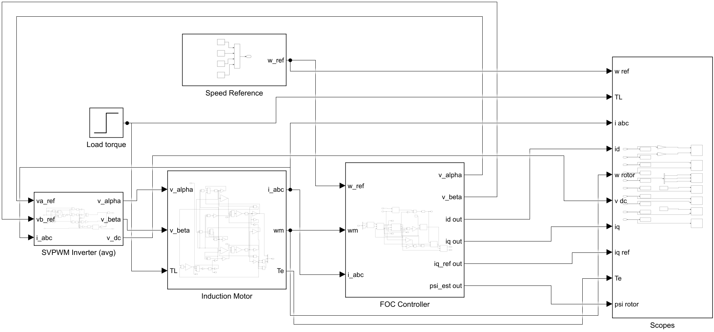

Le panneau **Scopes** regroupe la vitesse, le couple, les courants de phase, les courants d et q, le flux rotorique et la tension du bus continu. Les courbes de vitesse, de courant d et q et de flux permettent de comparer la grandeur mesurée ou estimée à sa consigne.

Soit $d=[d_a,d_b,d_c]^\top$ le vecteur des rapports cycliques, et $M$ la matrice de Clarke. Le pont moyen idéal vérifie $i_{\rm pont}=d^\top i_{abc}$ et $v_{\alpha\beta}=v_{dc}Md$.

$$
\frac{di_s}{dt}=\frac{V_s-R_{\rm dc}i_s-v_{dc}}{L_{\rm dc}},\qquad
\frac{dv_{dc}}{dt}=\frac{i_s-d^\top i_{abc}}{C_{\rm dc}}.
$$

En posant $g=Md$ et $x_{\rm IM}=[i_\alpha,i_\beta,\psi_{r\alpha},\psi_{r\beta}]^\top$, on obtient pour l’état augmenté $x=[i_s,\ v_{dc},\ x_{\rm IM}^{\top}]^\top$ la matrice électrique suivante.

$$
A(d,\omega_r)=
\begin{bmatrix}
-R_{\rm dc}/L_{\rm dc} & -1/L_{\rm dc} & 0_{1\times4}\\
1/C_{\rm dc} & 0 & -\dfrac{3}{2C_{\rm dc}}\begin{bmatrix}g^\top&0&0\end{bmatrix}\\
0_{4\times1} & B_{\rm IM}g & A_{\rm IM}(\omega_r)
\end{bmatrix}.
$$

Les termes en $g$ lient la commande à la matrice d’état. Le courant prélevé par le pont et la tension fournie au moteur dépendent ainsi des rapports cycliques. Le sous-système calcule ces produits avec les valeurs moyennes.

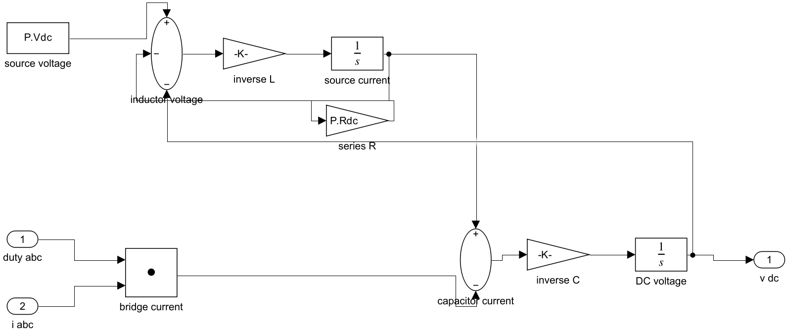

Les composants de simulation sont $R_{\rm dc}=0{,}10$ Ω, $L_{\rm dc}=0{,}5$ mH et $C_{\rm dc}=2{,}2$ mF. Le condensateur est préchargé à 540 V. La tension du bus varie de **536,4 à 544,9 V**. Les quatre échelons s’établissent à $\pm10$ tr/min en 70, 68, 52 et 59 ms. La chute au moment de l’application de la charge est de 69,17 tr/min.

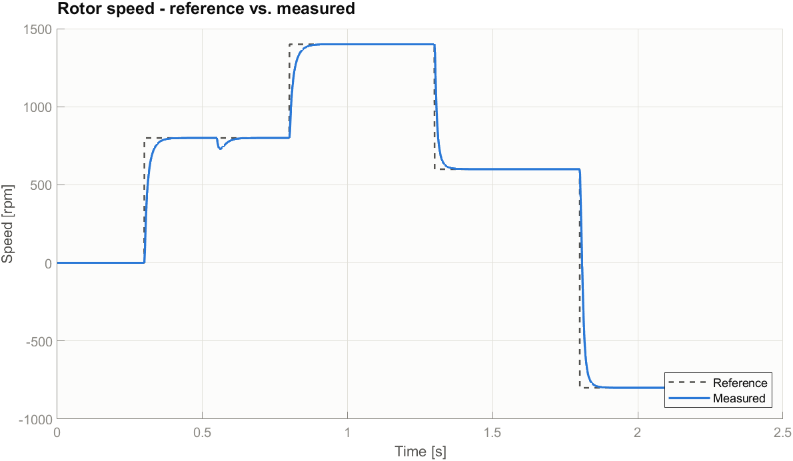

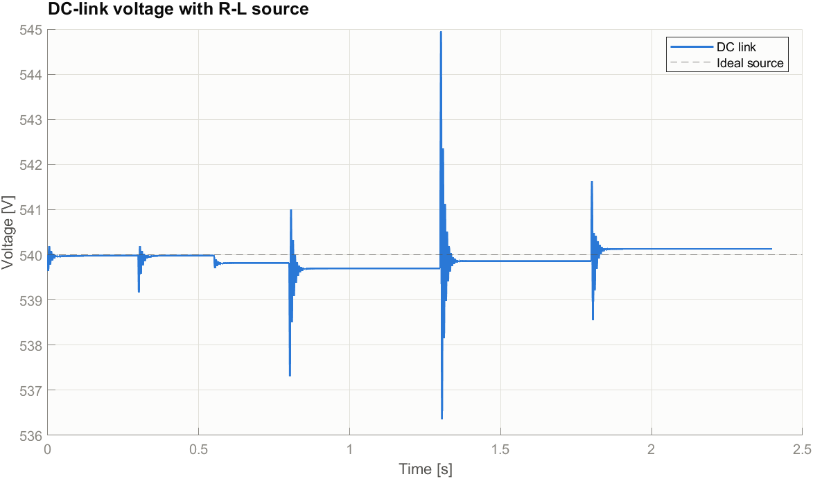

### 6.2 Simscape Electrical et comparaison des modulations

Le second modèle utilise la machine asynchrone et le pont universel à IGBT de la bibliothèque Simscape Electrical. Deux courants de phase sont mesurés, et le troisième est reconstruit par $i_c=-i_a-i_b$. Les blocs de Park SPS utilisent une convention sinus. Une permutation et un changement de signe les raccordent à la convention cosinus de la commande.

Les impulsions sont calculées dans le modèle. En SPWM, un comparateur confronte les consignes à la porteuse. En SVPWM, le secteur, les durées et l’ordre des sept segments déterminent l’état de chaque bras. Les deux essais utilisent la même grille de simulation de 1 µs.

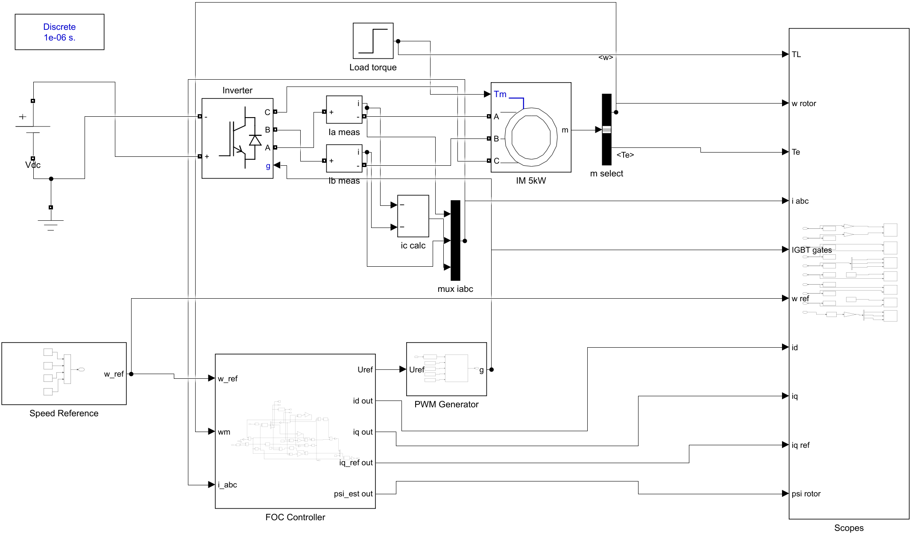

Le panneau **Scopes** affiche aussi les commandes des trois IGBT supérieurs. La fenêtre des commandes couvre six périodes à 10 kHz. La courbe des courants de phase montre l’ondulation de commutation au pas de simulation électrique.

La commande `compare_foc_pwm`, dans `matlab/simulink_library`, lance les deux simulations et exporte les courbes et le tableau de mesures.

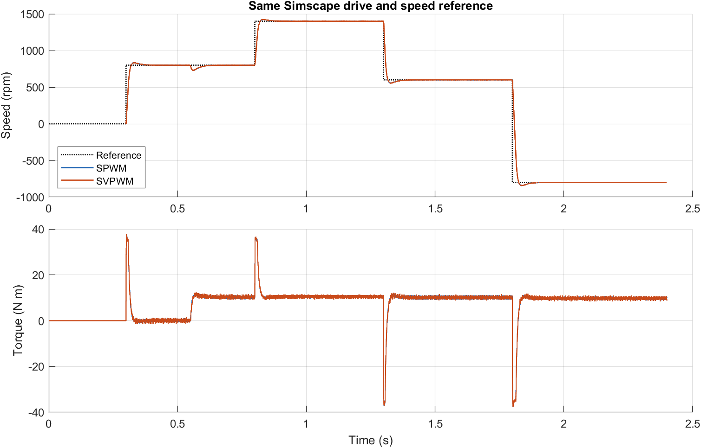

Les réponses en vitesse et en couple sont proches à l’échelle de l’essai complet. Le détail montre six périodes de commutation de **1,1050 à 1,1056 s**. La tension A–B idéale est reconstruite à partir des impulsions de grille. Les courants proviennent de la machine simulée.

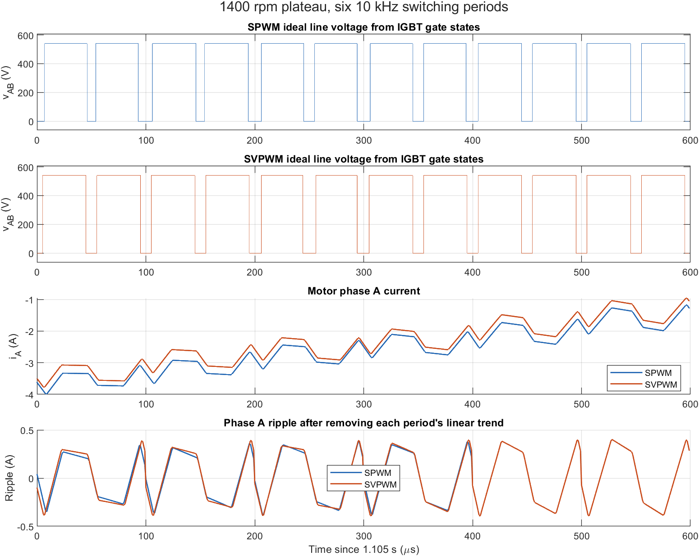

| Même essai Simscape | SPWM | SVPWM à sept segments |
|---|---:|---:|
| Établissement à ±10 tr/min (ms) | 65,3 / 59,0 / 67,7 / 75,0 | 69,1 / 57,5 / 70,3 / 73,1 |
| Écart de vitesse établi maximal (tr/min) | 1,67 | 2,26 |
| Chute de vitesse à l’application de la charge (tr/min) | 69,86 | 69,70 |
| Flux rotorique estimé final (Wb) | 0,800 | 0,800 |
| Courant de phase crête (A) | 20,48 | 20,51 |
| Ondulation efficace à 1400 tr/min (A) | 0,254 | 0,234 |
| Ondulation crête à crête moyenne à 1400 tr/min (A) | 0,944 | 0,848 |

L’ondulation est calculée sur le palier de 1400 tr/min entre 1,05 et 1,25 s. Une tendance linéaire est retirée de chaque phase à chaque période de commutation. Sur cet essai, la SVPWM réduit l’ondulation efficace de **7,7 %** et l’ondulation crête à crête moyenne de **10,2 %**. La SPWM donne le plus faible écart de vitesse en régime établi.

### 6.3 Implémentation numérique en Python

La troisième version étudie le même entraînement dans un environnement différent. Les équations stationnaires de la machine sont intégrées par Runge-Kutta d’ordre quatre. Le moteur, les transformations, les PI, l’estimateur et l’onduleur sont séparés en modules. L’onduleur moyen facilite l’observation des états internes, dont les deux composantes du flux.

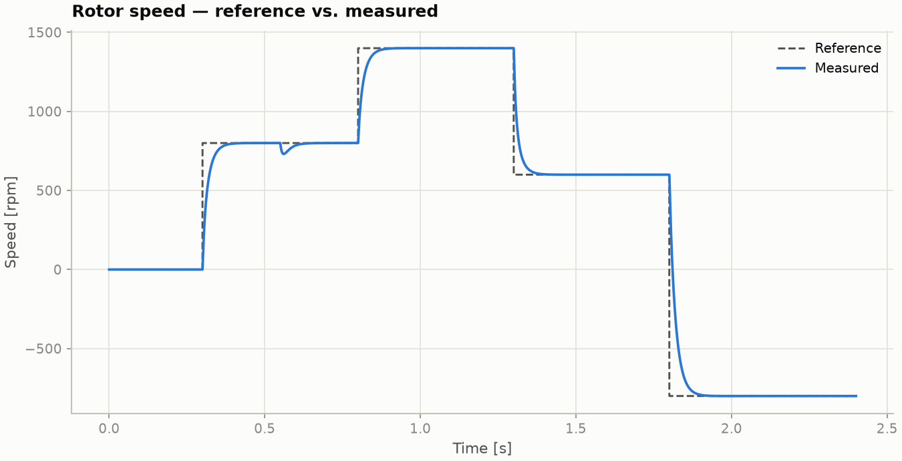

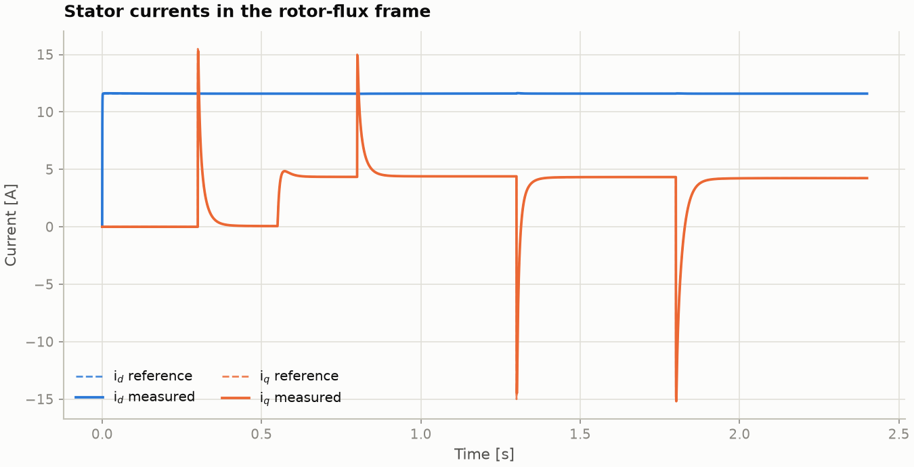

Les temps d’établissement sont de 79, 75, 71 et 95 ms. La chute à l’application de la charge est de 69,0 tr/min. Le flux rotorique final est de 0,800 Wb et la composante résiduelle sur q est d’environ 0,013 Wb.

L’essai complémentaire à vide impose une rampe de 0 à 1000 tr/min entre 0,30 et 0,90 s, puis un palier jusqu’à 1,20 s. L’écart maximal est de 0,08 tr/min sur la partie établie de la rampe, de 0,50 à 0,88 s, et de 0,16 tr/min sur le palier de 1,00 à 1,20 s. Les pointes au début et à la fin de la rampe coïncident avec les changements d’accélération demandée.

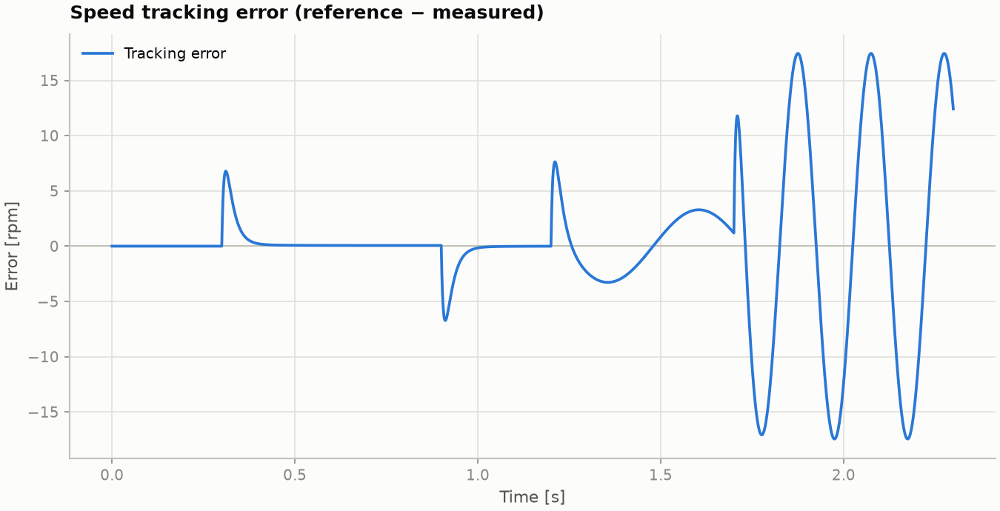

## 7. Conclusion

| Essai commun | Python | Simulink à blocs | Simscape SPWM | Simscape SVPWM |
|---|---:|---:|---:|---:|
| Chute de vitesse à la charge (tr/min) | 69,0 | 69,17 | 69,86 | 69,70 |
| Flux final ou estimé (Wb) | 0,800 | 0,800 | 0,800 | 0,800 |
| Courant de phase crête (A) | 19,1 | 19,92 | 20,48 | 20,51 |

Les trois modèles reproduisent les échelons de vitesse, l’inversion et le rejet de charge. Les blocs fondamentaux donnent accès aux équations du moteur et du bus continu. Python fournit une implémentation numérique indépendante. Le pont commuté de Simscape donne accès aux impulsions et à l’ondulation du courant pour comparer les modulations. La consigne de flux est fixe et l’orientation indirecte utilise la constante de temps rotorique nominale.

## Annexe A. Équations de la machine dans le repère fixe

On définit $J_{90}=\begin{bmatrix}0&-1\\1&0\end{bmatrix}$, $\omega_r=p\omega_m$, $\sigma=1-L_m^2/(L_sL_r)$ et $R_\sigma=R_s+R_r(L_m/L_r)^2$. Le flux rotorique et le courant statorique sont des vecteurs à deux composantes.

$$
\dot{\boldsymbol{\psi}}_r=-\frac{\boldsymbol{\psi}_r}{\tau_r}
+\omega_r J_{90}\boldsymbol{\psi}_r+\frac{L_m}{\tau_r}\boldsymbol{i}_s,
$$

$$
\dot{\boldsymbol{i}}_s=\frac{1}{\sigma L_s}
\left(\boldsymbol{v}_s-R_\sigma\boldsymbol{i}_s+
\frac{L_m}{L_r\tau_r}\boldsymbol{\psi}_r
-\frac{L_m}{L_r}\omega_rJ_{90}\boldsymbol{\psi}_r\right).
$$

$$
T_e=\frac32p\frac{L_m}{L_r}(\psi_{r\alpha}i_{s\beta}-\psi_{r\beta}i_{s\alpha}),
\qquad
J\dot{\omega}_m=T_e-T_L-B\omega_m.
$$

La formulation avec le courant rotorique comme état se déduit de $\boldsymbol{\psi}_r=L_r\boldsymbol{i}_r+L_m\boldsymbol{i}_s$. L’inductance transitoire vaut $\sigma L_s=3{,}94$ mH et la matrice d’entrée est $B_{\rm IM}=[I_2/(\sigma L_s);\ 0_{2\times2}]$.

## Annexe B. Calcul des gains PI à partir du modèle physique

Un PI applique $u(t)=K_p e(t)+K_i\int_0^t e(\tau)\,d\tau$. Le terme proportionnel répond à l’erreur instantanée. Le terme intégral accumule la correction de tension ou de couple nécessaire pour éliminer une erreur persistante. Les PI de courant délivrent des tensions et le PI de vitesse délivre une demande de couple. Les fréquences de 400 Hz pour le courant et de 30 Hz pour la vitesse sont des choix de réglage. Les paramètres de la machine donnent les gains correspondants.

### B.1 PI des courants sur les axes d et q

**Du flux au modèle électrique.** Le flux statorique s’écrit $\boldsymbol\psi_s=L_s\boldsymbol i_s+L_m\boldsymbol i_r$. En remplaçant le courant rotorique par $\boldsymbol i_r=(\boldsymbol\psi_r-L_m\boldsymbol i_s)/L_r$, on sépare la contribution du courant statorique de celle du flux rotorique.

$$
\boldsymbol\psi_s=L_\sigma\boldsymbol i_s+\frac{L_m}{L_r}\boldsymbol\psi_r,\qquad
L_\sigma=L_s-\frac{L_m^2}{L_r}=\sigma L_s=3{,}944\ \mathrm{mH}.
$$

Dans $v_s=R_s i_s+d\psi_s/dt$ sur chaque axe fixe, la dérivée du flux rotorique de l’annexe A contient le terme de courant $(L_m/L_r)(L_m/\tau_r)i_s$. En l’ajoutant à la chute de tension résistive statorique, on obtient

$$
R_\sigma=R_s+\frac{L_m^2}{L_r\tau_r}
        =R_s+R_r\left(\frac{L_m}{L_r}\right)^2
        =1{,}206\ \Omega.
$$

L’inductance fixe la tension nécessaire pour faire varier rapidement le courant. La résistance équivalente réunit la résistance statorique et la contribution du rotor ramenée par le couplage magnétique. Le réglage des deux PI s’appuie sur le même modèle nominal $G_i(s)=1/(L_\sigma s+R_\sigma)$. Ce modèle isole la dynamique électrique rapide. Les autres termes de flux et de vitesse sont traités comme des perturbations ou compensés par anticipation. La simulation conserve les équations complètes de la machine. [Commande des courants en FOC à flux rotorique orienté](https://imperix.com/doc/implementation/rotor-field-oriented-control)

**Placer le zéro et fixer la pulsation de coupure.** Le PI s’écrit $C_i(s)=K_{p,i}(s+K_{i,i}/K_{p,i})/s$. On place son zéro au pôle électrique nominal avec $K_{i,i}/K_{p,i}=R_\sigma/L_\sigma$. La boucle ouverte devient $C_i(s)G_i(s)=K_{p,i}/(L_\sigma s)$. En imposant un gain unitaire à $\omega_{ci}=2\pi\cdot400=2513{,}3$ rad/s, on obtient les coefficients utilisés par **chacun** des deux PI de courant.

$$
K_{p,i}=L_\sigma\omega_{ci}=9{,}91\ \mathrm{V/A},\qquad
K_{i,i}=R_\sigma\omega_{ci}=3030{,}19\ \mathrm{V/(A\,s)}.
$$

Pour une erreur de 1 A, le terme proportionnel demande immédiatement environ 9,91 V. Si l’erreur persiste, le terme intégral continue d’ajuster la tension.

### B.2 PI de vitesse

**Du couple à l’accélération.** L’équation mécanique est $J\dot\omega_m=T_e-T_L-B\omega_m$. En supposant que les boucles de courant, plus rapides, réalisent le couple demandé, le modèle du couple vers la vitesse est $G_\omega(s)=1/(Js+B)$. Pour une fréquence de coupure de 30 Hz, la pulsation $\omega_{cs}=188{,}5$ rad/s est très supérieure à $B/J=0{,}268$ rad/s. L’inertie domine et $G_\omega(s)\simeq 1/(Js)$.

Le terme proportionnel fournit un couple correctif en fonction de l’erreur de vitesse. Pour obtenir un gain nominal unitaire à $\omega_{cs}$, on choisit $K_{p,\omega}=J\omega_{cs}$. Le zéro du PI est placé à une pulsation cinq fois plus faible, $\omega_z=\omega_{cs}/5=2\pi\cdot6$ rad/s. D’où $K_{i,\omega}=K_{p,\omega}\omega_z$. Le proportionnel domine ainsi près de la pulsation de coupure, tandis que l’intégrale établit le couple nécessaire pour équilibrer la charge et les frottements à erreur de vitesse nulle.

$$
K_{p,\omega}=0{,}0056(2\pi\cdot30)=1{,}056\ \mathrm{N\,m\,s/rad},\qquad
K_{i,\omega}=\frac{K_{p,\omega}\omega_{cs}}{5}
           =39{,}79\ \mathrm{N\,m/rad}.
$$

Ces gains sont les valeurs nominales de réglage en temps continu utilisées dans le code. Les implémentations discrètes mettent à jour les régulateurs toutes les 100 µs. Les réponses aux échelons dépendent aussi des limites de courant et de couple.

## Références

1. W. Leonhard, *Control of Electrical Drives*, Springer, 2001.
2. P. C. Krause, O. Wasynczuk, S. D. Sudhoff et S. Pekarek, *Analysis of Electric Machinery and Drive Systems*, Wiley-IEEE Press, 2013.
3. P. Vas, *Vector Control of AC Machines*, Oxford University Press, 1990.
4. Texas Instruments, [Space-Vector PWM with TMS320C24x](https://www.ti.com/lit/an/spra524/spra524.pdf).
5. Imperix, [Space Vector Modulation](https://imperix.com/doc/implementation/space-vector-modulation).
6. MathWorks, [Three-Phase Two-Level PWM Generator](https://www.mathworks.com/help/simscape-electrical/ref/pwmgeneratorthreephasetwolevel.html).
