# Field-Oriented Control of a Squirrel-Cage Induction Motor

**Simulation of a 5 kW drive with fundamental Simulink blocks, Simscape Electrical, and Python**

*November 2026*

## 1. Why use field-oriented control?

An induction motor creates torque through the interaction of rotor flux and stator current. The three stator currents are alternating quantities, and the rotor flux rotates at a speed that differs from the mechanical rotor speed. Controlling the three phase currents directly makes it hard to see which part of the current builds the magnetic field and which part produces torque.

Field-oriented control (FOC) expresses the stator current in a reference frame that follows the rotor flux. The current along the flux axis, $i_d$, sets the rotor flux. The perpendicular current, $i_q$, sets the torque for a given flux. This gives the drive separate references for magnetization and torque, much like the field and armature currents of a separately excited DC machine. The speed controller can then request the torque needed to accelerate the rotor or reject a load disturbance.

## 2. Control architecture

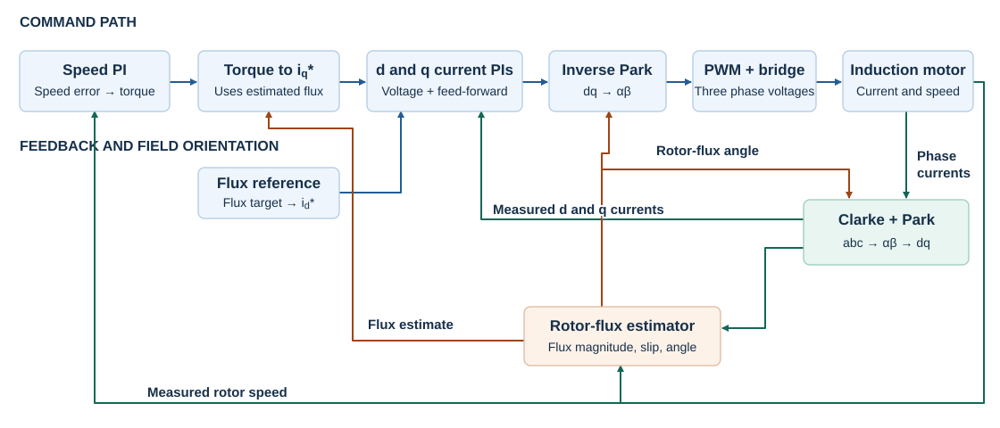

The outer PI compares the speed reference and the motor-model speed, then outputs a torque request $T_e^*$. The controller converts it to a stator current reference. The flux target sets the other current reference.

$$
i_q^*=\frac{T_e^*}{K_T\hat{\psi}_r},\qquad
K_T=\frac32p\frac{L_m}{L_r},\qquad
i_d^*=\frac{\psi_r^*}{L_m}.
$$

The drive uses $\psi_r^*=0.8$ Wb, giving $i_d^*=11.59$ A. The torque request is limited to $\pm35$ N m. The q-axis reference also respects the current budget left after magnetization, $|i_q^*|\leq\sqrt{I_{\max}^2-i_d^{*2}}$ with $I_{\max}=25$ A. A minimum flux value protects the division during startup.

The two inner PIs compare $i_d^*,i_q^*$ with measured $i_d,i_q$ and produce $v_d^*,v_q^*$ with feed-forward compensation. Inverse Park converts the voltage command to a stationary arrow, and the modulator and bridge apply the requested voltage to the machine.

## 3. Clarke, Park, and indirect rotor-flux orientation

### 3.1 Clarke represents three phases as a stationary arrow

The A, B, and C axes lie at $0^\circ$, $120^\circ$, and $240^\circ$. Project each phase reading onto a fixed horizontal axis $\alpha$ and vertical axis $\beta$. Adding the projections gives a raw vector with $3/2$ of the phase amplitude for a balanced set. The $2/3$ normalization recovers the original amplitude.

$$
\begin{bmatrix}x_\alpha\\x_\beta\end{bmatrix}
=\frac23
\begin{bmatrix}1&-1/2&-1/2\\0&\sqrt3/2&-\sqrt3/2\end{bmatrix}
\begin{bmatrix}x_a\\x_b\\x_c\end{bmatrix}.
$$

For example, $(10,-5,-5)$ A gives $(10,0)$ A. The B and C vertical contributions cancel and their horizontal contributions add to A. For balanced three-wire currents, two coordinates fully describe the phase set. The same Clarke matrix removes a voltage offset shared by all three inverter legs.

### 3.2 Park rotates the axes to follow the rotor flux

Clarke's axes are stationary. Park uses $\theta_e$, the electrical angle of the rotor-flux field, to rotate the coordinate axes. The d axis follows the flux and the q axis leads it by $90^\circ$.

$$
\begin{bmatrix}x_d\\x_q\end{bmatrix}
=\begin{bmatrix}\cos\theta_e&\sin\theta_e\\-\sin\theta_e&\cos\theta_e\end{bmatrix}
\begin{bmatrix}x_\alpha\\x_\beta\end{bmatrix},\qquad
\begin{bmatrix}x_\alpha\\x_\beta\end{bmatrix}
=\begin{bmatrix}\cos\theta_e&-\sin\theta_e\\\sin\theta_e&\cos\theta_e\end{bmatrix}
\begin{bmatrix}x_d\\x_q\end{bmatrix}.
$$

If the flux angle is correct, the rotor flux reads $(\psi_{rd},\psi_{rq})=(\psi_r,0)$. Stator current can still have both components. The aligned machine equations show their roles.

$$
\tau_r\frac{d\psi_r}{dt}+\psi_r=L_m i_d,\qquad
T_e=\frac32p\frac{L_m}{L_r}\psi_r i_q,\qquad
J\frac{d\omega_m}{dt}=T_e-T_L-B\omega_m.
$$

The rotor flux changes gradually with $i_d$ over the rotor time constant. At fixed flux, changing $i_q$ changes torque. Speed changes when that torque differs from load and friction. If flux rises while the requested torque stays fixed, the torque-to-current conversion requests less $i_q$.

### 3.3 Estimate the flux magnitude, slip, and field angle

The indirect estimator combines measured stator current, machine parameters, and rotor speed from the plant model.

1. **Estimate the flux magnitude.** Filter $i_d$ through the rotor lag, $\hat{\psi}_r(s)=L_m i_d(s)/(1+\tau_r s)$. The rotor resistance $R_r$ is a model parameter used in $\tau_r=L_r/R_r=87.0$ ms.
2. **Calculate electrical slip.** Use the torque-producing current and the estimated flux, $\omega_{\rm sl}=L_m i_q/(\tau_r\max(\hat{\psi}_r,\psi_{\min}))$. For the same flux, more $i_q$ requires more slip.
3. **Update the field angle.** Add the electrical rotor speed $p\omega_m$ to slip, then integrate. $\theta_e=\int(p\omega_m+\omega_{\rm sl})\,dt$. This angle describes the rotating rotor-flux field.

### 3.4 How the two current loops work together

Flux alignment separates the flux and torque relationships. The d and q voltage equations still contain speed-dependent coupling terms. The current controllers add feed-forward voltages that counter these terms.

$$
v_{d,\rm ff}=-\omega_e\sigma L_s i_q,\qquad
v_{q,\rm ff}=\omega_e\left(\sigma L_s i_d+\frac{L_m}{L_r}\hat{\psi}_r\right).
$$

For example, raising $i_q^*$ produces a q-axis voltage to raise $i_q$ and a d-axis feed-forward correction to help the d-axis loop hold $i_d$. Correct flux orientation makes the two current readings meaningful. The current PIs and the feed-forward terms help each measured current follow its own reference.

| Loop | Nominal bandwidth | Proportional gain | Integral gain |
|---|---:|---:|---:|
| d- and q-axis current | 400 Hz | 9.91 V/A | 3030 V/(A s) |
| Speed | 30 Hz | 1.056 N m s/rad | 39.79 N m/rad |

The current design uses the equivalent plant $1/(\sigma L_s s+R_\sigma)$, with $K_p=\sigma L_s\omega_{ci}$ and $K_i=R_\sigma\omega_{ci}$. For speed, $K_p=J\omega_{cs}$ and $K_i=K_p\omega_{cs}/5$. The inner loop is faster so the current can respond to torque requests before the outer loop changes them appreciably. The fundamental-block and Python controllers use back-calculation anti-windup. The Simscape controller uses discrete PI blocks with clamping.

## 4. Two ways to switch the same IGBT bridge

The three bits specify the upper gate commands for legs A, B, and C. A `1` connects the leg to the positive rail and a `0` to the negative rail in the ideal switching model. The lower gate is complementary. Both algorithms use a 10 kHz PWM period of 100 µs.

### 4.1 Sinusoidal PWM

Inverse Clarke gives phase-voltage commands from the stationary voltage arrow. The SPWM algorithm divides each by $V_{dc}/2$, holds each normalized reference for the PWM period, and compares it with a shared triangle that runs between $-1$ and $+1$. When a phase command exceeds the carrier, its upper gate goes high. A larger reference makes a wider pulse and a higher period-average pole voltage. The three references are separated by $120^\circ$ in steady balanced operation.

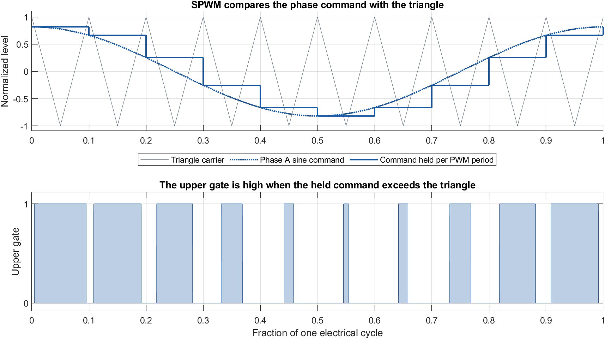

*The illustration shows ten carrier cycles per electrical cycle for readability. The simulated drive uses a 10 kHz carrier.*

With the phase references applied directly, the linear phase-voltage peak is $V_{dc}/2=270$ V. [MathWorks PWM reference](https://www.mathworks.com/help/simscape-electrical/ref/pwmgeneratorthreephasetwolevel.html)

### 4.2 Space-vector PWM and the 360 V active vectors

For `100`, take the negative rail as 0 V. The terminal voltages are $(540,0,0)$ V. Applying Clarke gives the first active vector.

$$
V_\alpha=\frac{V_{AB}+V_{AC}}{3}=\frac{540+540}{3}=360\ \mathrm{V},\qquad
V_\beta=\frac{V_{BC}}{\sqrt3}=0.
$$

For `110` the pole voltages are $(540,540,0)$ V, giving $(180,311.8)$ V. Its magnitude is also 360 V and it lies at $60^\circ$. Equivalently, its components are $360\cos60^\circ$ and $360\sin60^\circ$. The six active vectors are the corners of the voltage hexagon. The states `000` and `111` give zero line-to-line voltage because all three terminals share one rail.

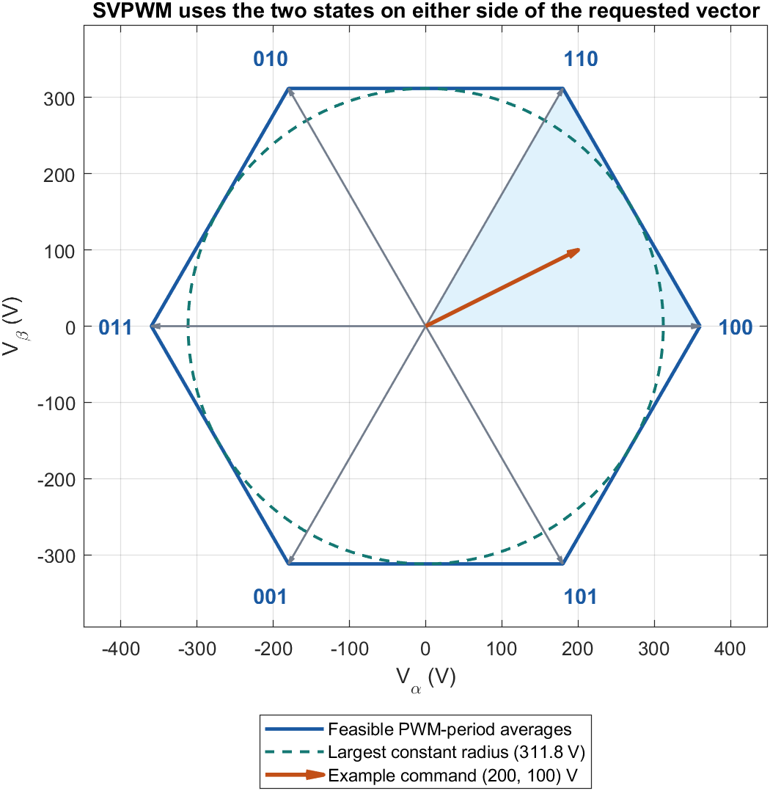

The 360 V value is $2V_{dc}/3$, the largest $\alpha$ component at the `100` corner. At $30^\circ$, the largest reachable arrow is the midpoint of the edge joining `100` and `110`, with magnitude $360\cos30^\circ=311.8$ V. A constant-magnitude arrow must fit at every angle to produce balanced sine waves. Its linear limit is therefore $V_{dc}/\sqrt3=311.8$ V, about 15.5% above the SPWM limit. [Voltage hexagon and active vectors](https://imperix.com/doc/implementation/space-vector-modulation)

### 4.3 Seven-segment algorithm and worked example

1. **Find the sector.** For the requested $(V_\alpha^*,V_\beta^*)=(200,100)$ V, the angle is $26.6^\circ$. It lies between `100` at $0^\circ$ and `110` at $60^\circ$.
2. **Calculate total time in each state.** Only `110` contributes to $\beta$ here, so it takes $100/311.8$ of the period, or 32.08 µs. It also supplies about 57.7 V of average $\alpha$ voltage. State `100` supplies the remaining 142.3 V with 39.52 µs at 360 V. The two zero states share the remaining 28.41 µs.
3. **Place the times in order.** Start at `000`, visit the active state with one high bit, then the active state with two, then `111`. Retrace the order. The high-bit rule works in every sector. Split each active dwell across its two visits, and split the zero time equally between the two zero states.

| State | `000` | `100` | `110` | `111` | `110` | `100` | `000` |
|---|---:|---:|---:|---:|---:|---:|---:|
| Time in µs, rounded | 7.10 | 19.76 | 16.04 | 14.20 | 16.04 | 19.76 | 7.10 |

The general calculation uses the reference magnitude $R_v$, its angle $\delta$ measured from the start of the sector, and the period $T_s$.

$$
T_1=T_s\frac{\sqrt3 R_v}{V_{dc}}\sin(60^\circ-\delta),\qquad
T_2=T_s\frac{\sqrt3 R_v}{V_{dc}}\sin\delta,\qquad
T_0=T_s-T_1-T_2.
$$

If $T_1+T_2>T_s$, the requested voltage is outside the hexagon in that direction. Changing the switching frequency changes the absolute times but preserves the fraction of the period required. The implementation scales the two active times by the same factor when they exceed the period. [TI space-vector PWM implementation](https://www.ti.com/lit/an/spra524/spra524.pdf)

The fundamental-block and Python average-value models use an equivalent centered modulator. They add a common offset $-\tfrac12(\max(v_a^*,v_b^*,v_c^*)+\min(v_a^*,v_b^*,v_c^*))$ to the three phase commands. This centers their highest and lowest values while preserving phase-to-phase voltage differences. The Simscape SVPWM model explicitly lays out the seven timed states. [TI min-max implementation](https://software-dl.ti.com/processor-industrial-sw/esd/motor_control_sdk/am243x/2025_00_00_06/docs/api_guide_am243x/svgen_8h_source.html)

## 5. Common machine and test conditions

| Parameter | Value | Parameter | Value |
|---|---:|---|---:|
| Rated power | 5 kW | Rated line voltage | 380 V RMS |
| Pole pairs $p$ | 2 | Rated current | 10.5 A |
| $R_s$ | 0.435 Ω | $R_r$ | 0.816 Ω |
| $L_s$, $L_r$ | 71 mH each | $L_m$ | 69 mH |
| Inertia $J$ | 0.0056 kg m² | Viscous friction $B$ | 0.0015 N m s/rad |

The 2.4 s test starts at standstill and allows the flux to build. Speed steps reach 800, 1400, 600, and $-800$ rpm at 0.30, 0.80, 1.30, and 1.80 s. A positive 10 N m load torque is applied at 0.55 s and stays applied through the reversal. The switching comparison uses the same model, bridge, controller, 540 V source, test conditions, and 1 µs electrical time step for both modes. Only the modulation selection changes.

## 6. Implementation and results

### 6.1 MATLAB and Simulink with fundamental blocks

The first model implements the stationary-frame motor equations, PI controllers, reference transforms, and flux estimator using sums, gains, products, and integrators. The bridge uses the average pole voltages over a PWM period. The DC source drives the link through a series resistance and inductance, and a capacitor supplies the difference between source and bridge current.

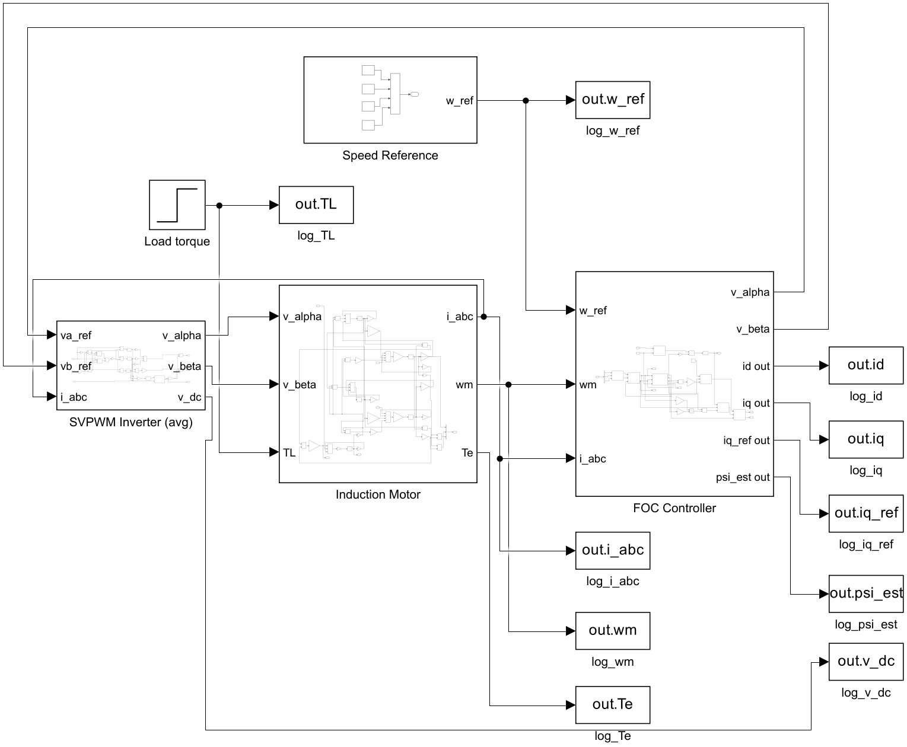

The modulator supplies the duty vector $d=[d_a,d_b,d_c]^\top$. For an ideal averaged bridge, $i_{\rm bridge}=d^\top i_{abc}$ and $v_{\alpha\beta}=v_{dc}Md$, where $M$ is the Clarke matrix. Thus the same command that changes the voltage applied to the motor changes the current drawn from the link.

$$
\frac{di_s}{dt}=\frac{V_s-R_{\rm dc}i_s-v_{dc}}{L_{\rm dc}},\qquad
\frac{dv_{dc}}{dt}=\frac{i_s-d^\top i_{abc}}{C_{\rm dc}}.
$$

Here $i_s$ is the DC source current. For the augmented electrical state $x=[i_s,\ v_{dc},\ x_{\rm IM}^{\top}]^\top$, let $x_{\rm IM}=[i_\alpha,i_\beta,\psi_{r\alpha},\psi_{r\beta}]^\top$, $g=Md$, and let $B_{\rm IM}$ map the stationary voltage into the motor electrical equations. The command-dependent state matrix is

$$
A(d,\omega_r)=
\begin{bmatrix}
-R_{\rm dc}/L_{\rm dc} & -1/L_{\rm dc} & 0_{1\times4}\\
1/C_{\rm dc} & 0 & -\dfrac{3}{2C_{\rm dc}}\begin{bmatrix}g^\top&0&0\end{bmatrix}\\
0_{4\times1} & B_{\rm IM}g & A_{\rm IM}(\omega_r)
\end{bmatrix}.
$$

The upper-right coupling uses $d^\top i_{abc}=\tfrac32g^\top i_{\alpha\beta}$ for the three-wire load. The lower-left voltage coupling uses $B_{\rm IM}g$. The basic blocks evaluate these products directly. With a binary switching command, the same ideal bridge relationships describe the instantaneous topology. This version evaluates them with the average duty commands and the measured DC-link state.

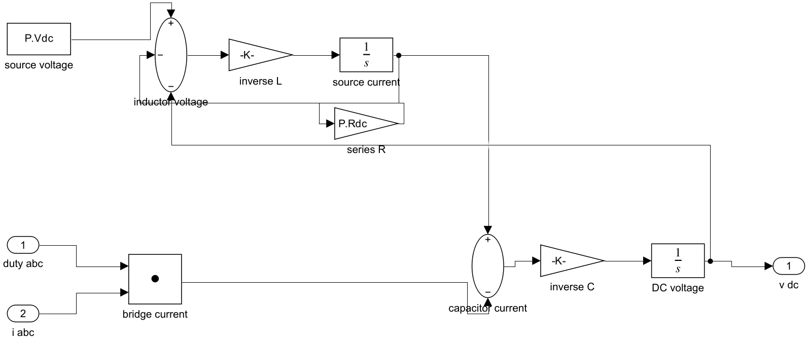

The illustrative component values are $R_{\rm dc}=0.10$ Ω, $L_{\rm dc}=0.5$ mH, and $C_{\rm dc}=2.2$ mF, with a precharged 540 V capacitor. They are simulation assumptions. The run gives a link range of **536.4 to 544.9 V**, including transient sag and rise as power flows between the motor and the link. The speed steps settle in 70, 68, 52, and 59 ms within $\pm10$ rpm. The load dip is 69.17 rpm and the final flux estimate is 0.800 Wb.

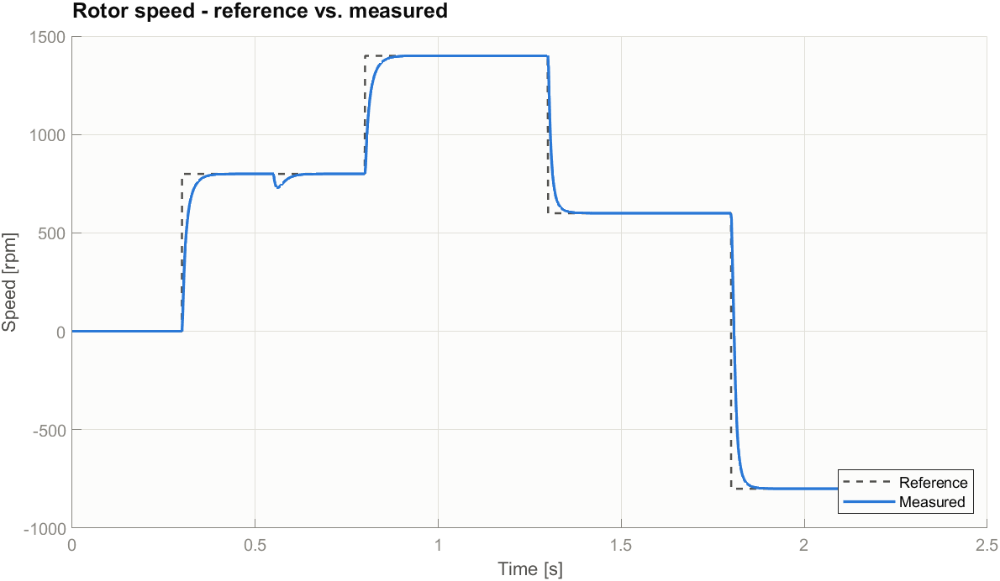

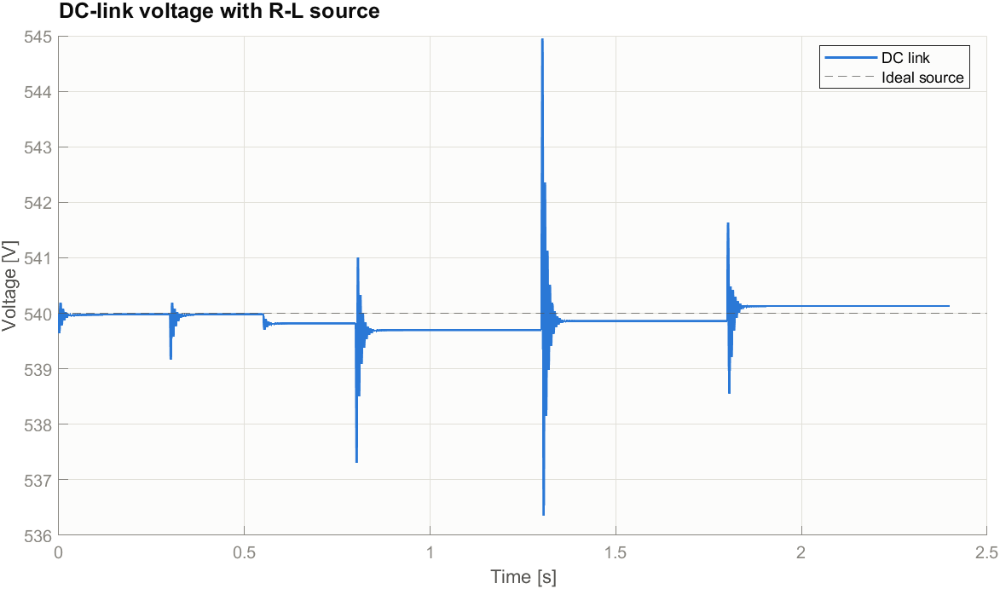

### 6.2 MATLAB and Simscape Electrical with the library IGBT bridge

The switching model uses the Simscape Electrical induction-machine and Universal Bridge blocks with discrete controllers. It measures two phase currents and reconstructs the third as $i_c=-i_a-i_b$. The SPS Park blocks use a sine reference, so the controller adapts the axis order and sign to its cosine-referenced convention. Both sets of gates come from a custom Simulink subsystem. SPWM compares held commands with the triangle. SVPWM calculates the sector and dwell times and evaluates the centered seven-segment sequence. Switching instants are resolved on the common 1 µs grid.

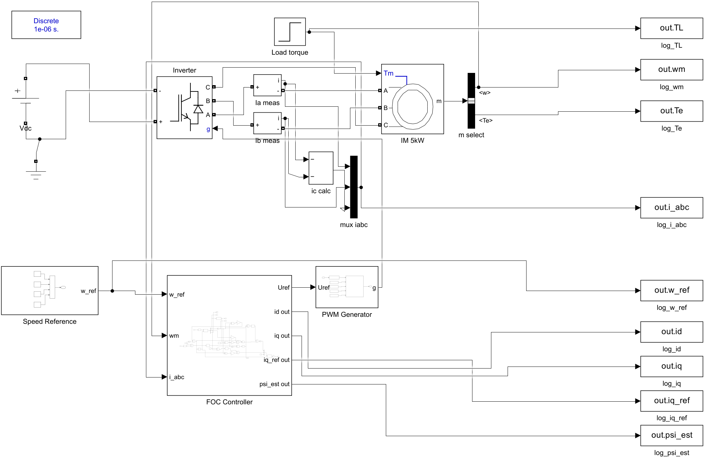

Run `compare_foc_pwm` in `matlab/simulink_library` to simulate both modes and regenerate the overlays and CSV.

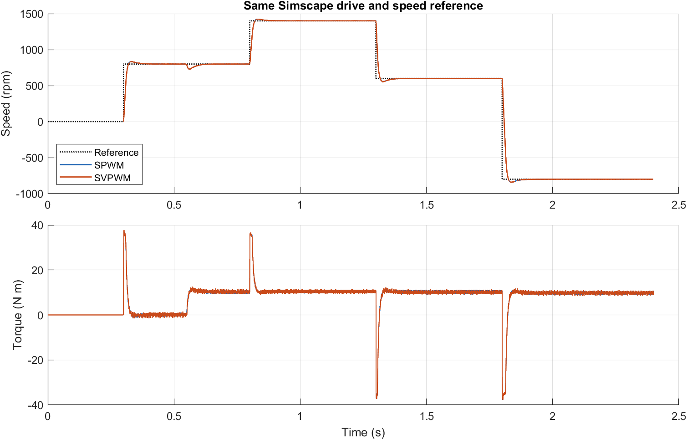

The speed and torque curves nearly overlap at the scale of the full test. The close-up shows six PWM periods from **1.1050 to 1.1056 s**. The voltage panels show the ideal A-to-B voltage from the gate states. The current panels use the simulated motor current.

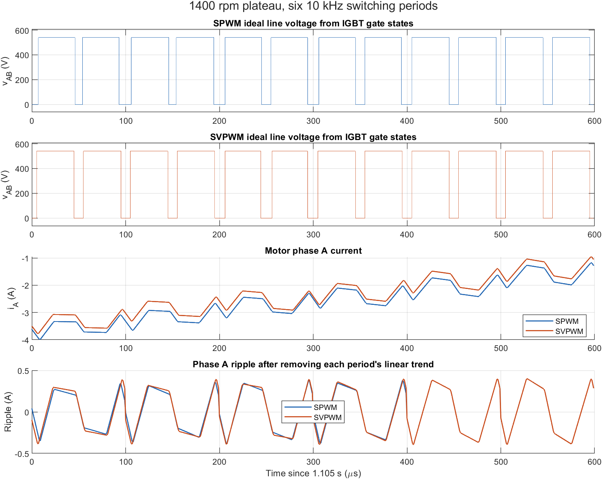

| Same Simscape test | SPWM | Seven-segment SVPWM |
|---|---:|---:|
| Settling to within ±10 rpm (ms) | 65.3 / 59.0 / 67.7 / 75.0 | 69.1 / 57.5 / 70.3 / 73.1 |
| Maximum settled speed error (rpm) | 1.67 | 2.26 |
| Load-step dip (rpm) | 69.86 | 69.70 |
| Final rotor-flux estimate (Wb) | 0.800 | 0.800 |
| Full-rate peak phase current (A) | 20.48 | 20.51 |
| Current ripple RMS at 1400 rpm (A) | 0.254 | 0.234 |
| Mean peak-to-peak current ripple at 1400 rpm (A) | 0.944 | 0.848 |

Ripple was evaluated over the 1.05 to 1.25 s portion of the 1400 rpm plateau. Each phase and PWM period was detrended with a fitted straight line before evaluating the RMS and mean peak-to-peak residual. In this test, SVPWM lowers those measures by **7.7%** and **10.2%**, respectively. SPWM gives the smaller settled speed error. These differences describe this operating point, controller, and time grid. The modulation change shifts the pulse timing while the speed loop continues to meet the same reference.

### 6.3 Python as an independent numerical implementation

The third model tests how the same engineering study can be built in Python. A fourth-order Runge-Kutta integrator advances the stationary-frame motor equations. The controller, transforms, estimator, inverter, and plotting are separate modules. The default average-value inverter makes it practical to run scenarios quickly and inspect internal states such as both rotor-flux components.

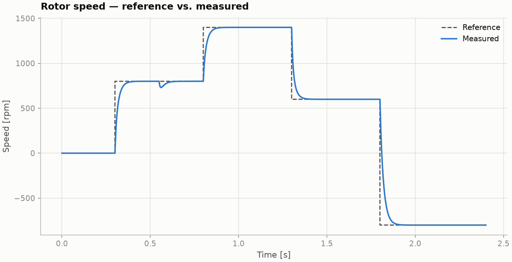

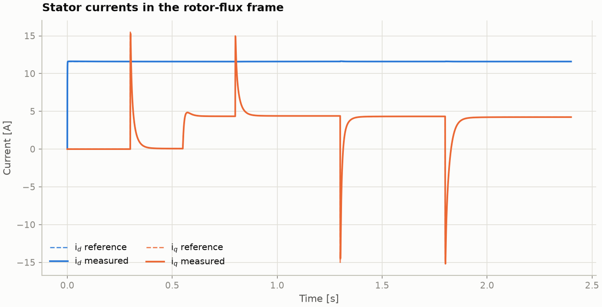

In the common scenario, the four settling times are 79, 75, 71, and 95 ms, the load dip is 69.0 rpm, and the final rotor flux is 0.800 Wb. During the speed changes, $i_q$ follows the torque demand while $i_d$ returns near its magnetizing reference. The final q-axis rotor-flux residual is about 0.013 Wb.

The Python-only unloaded tracking study ramps to 1000 rpm from 0.30 to 0.90 s and holds 1000 rpm until 1.20 s. The maximum speed error is 0.08 rpm during the settled ramp window of 0.50 to 0.88 s and 0.16 rpm during the hold window of 1.00 to 1.20 s. The motor inertia contributes an integrator and the PI contributes another, which explains the small settled ramp error. The larger errors at the start and end of the ramp occur as the requested acceleration changes.

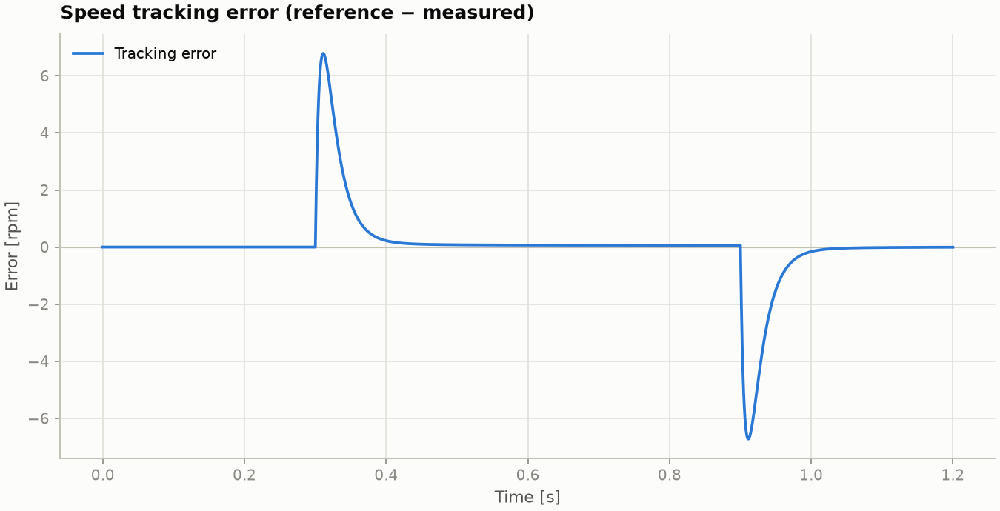

## 7. Conclusion

| Shared step test | Python | Fundamental Simulink | Simscape SPWM | Simscape SVPWM |
|---|---:|---:|---:|---:|
| Load-step dip (rpm) | 69.0 | 69.17 | 69.86 | 69.70 |
| Final rotor flux or estimate (Wb) | 0.800 | 0.800 | 0.800 | 0.800 |
| Peak phase current (A) | 19.1 | 19.92 | 20.48 | 20.51 |

The three implementations reproduce the speed steps, reversal, and load rejection with the same rotor-flux target. The fundamental blocks expose the motor and DC-link equations. Python provides an independent numerical model and makes it easy to add speed profiles. The Simscape bridge resolves individual switching pulses and makes the SPWM and SVPWM ripple comparison possible. The flux reference stays fixed in this study, and the indirect orientation uses the nominal rotor time constant.

## Appendix. Stationary-frame machine equations

Write the stator current and rotor flux as two-vectors in the stationary frame and define $J_{90}=\begin{bmatrix}0&-1\\1&0\end{bmatrix}$, $\omega_r=p\omega_m$, $\sigma=1-L_m^2/(L_sL_r)$, and $R_\sigma=R_s+R_r(L_m/L_r)^2$. The electrical equations implemented by the fundamental-block and Python models are

$$
\dot{\boldsymbol{\psi}}_r
=-\frac{\boldsymbol{\psi}_r}{\tau_r}+\omega_r J_{90}\boldsymbol{\psi}_r
+\frac{L_m}{\tau_r}\boldsymbol{i}_s,
$$

$$
\dot{\boldsymbol{i}}_s=\frac{1}{\sigma L_s}
\left(\boldsymbol{v}_s-R_\sigma\boldsymbol{i}_s+
\frac{L_m}{L_r\tau_r}\boldsymbol{\psi}_r
-\frac{L_m}{L_r}\omega_r J_{90}\boldsymbol{\psi}_r\right).
$$

$$
T_e=\frac32p\frac{L_m}{L_r}(\psi_{r\alpha}i_{s\beta}-\psi_{r\beta}i_{s\alpha}),
\qquad
J\dot{\omega}_m=T_e-T_L-B\omega_m.
$$

This uses rotor flux as an electrical state. The equivalent current-state formulation follows from $\boldsymbol{\psi}_r=L_r\boldsymbol{i}_r+L_m\boldsymbol{i}_s$. The resulting transient inductance is $\sigma L_s=3.94$ mH. The input matrix in section 6.1 is $B_{\rm IM}=[I_2/(\sigma L_s);\ 0_{2\times2}]$.

## References

1. W. Leonhard, *Control of Electrical Drives*, 3rd ed., Springer, 2001.
2. P. C. Krause, O. Wasynczuk, S. D. Sudhoff, and S. Pekarek, *Analysis of Electric Machinery and Drive Systems*, 3rd ed., Wiley-IEEE Press, 2013.
3. P. Vas, *Vector Control of AC Machines*, Oxford University Press, 1990.
4. Texas Instruments, [Space-Vector PWM with TMS320C24x](https://www.ti.com/lit/an/spra524/spra524.pdf).
5. Imperix, [Space Vector Modulation](https://imperix.com/doc/implementation/space-vector-modulation).
6. MathWorks, [Three-Phase Two-Level PWM Generator](https://www.mathworks.com/help/simscape-electrical/ref/pwmgeneratorthreephasetwolevel.html).
